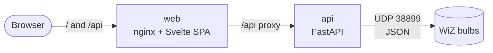

# WiZ control app

Find the WiZ smart bulbs on your local network, see their current state, and control them from the browser: on and off, brightness up and down, white temperature, and color on bulbs that support it.

It is also a learning project for **TDD** and **DDD** in the style of *Architecture Patterns with Python* (Cosmic Python).

- [**Decisions**](https://juan19932carlos.github.io/wiz-control-app/decisions/tech-stack): the lasting architecture choices (ADRs), each with the rejected option and the reason.
- [**Journal**](https://juan19932carlos.github.io/wiz-control-app/journal): the working journal, one entry per day, written from the author's own notes.

## How it works



- The **api** sweeps the LAN subnet over UDP to find bulbs, then reads and changes them with the WiZ JSON protocol.
- Each bulb reports what it supports. Not every bulb has color: white-only bulbs only get brightness and white temperature.
- The **web** container serves the single-page app and proxies `/api`, so the browser sees one origin and needs no CORS.
- The UI polls every 3 seconds, so changes made from a wall switch or the WiZ phone app show up.

## Run it

Needs Docker and a host on the same network as the bulbs.

```bash
cp .env.example .env        # set WIZ_TARGETS to your LAN subnet, for example 192.168.2.0/24
docker compose -f compose.prod.yaml up -d
```

Open `http://<host>:8080`. `compose.prod.yaml` runs the images published to GitHub Container Registry. `compose.yaml` builds them from this repo instead.

## Repository

| Path | What it is |
| --- | --- |
| `packages/wiz-protocol-py` | Async client for the WiZ UDP protocol, with discovery |
| `apps/server-py` | FastAPI server: domain, service layer, adapters, entrypoints |
| `apps/web-ts` | Svelte + TypeScript SPA with Tailwind and shadcn-svelte |
| `architecture/` | ADRs, journal, and the Docusaurus site that shows them |

Folders in `apps/` and `packages/` end in `-py` (uv workspace) or `-ts` (pnpm workspace).

## Develop

Tools are pinned with [mise](https://mise.jdx.dev): Python, uv, Node, and pnpm.

```bash
mise install
uv sync && pnpm install
uv run pytest                                      # no real bulbs needed
WIZ_TARGETS=192.168.2.0/24 uv run wiz-server       # API on 127.0.0.1:8000
pnpm dev:web                                       # UI on :5173, proxies /api
pnpm dev:docs                                      # this documentation site
```

CI runs the tests on every push and publishes the `wiz-control-server` and `wiz-control-web` images from `main` and from `v*` tags.
